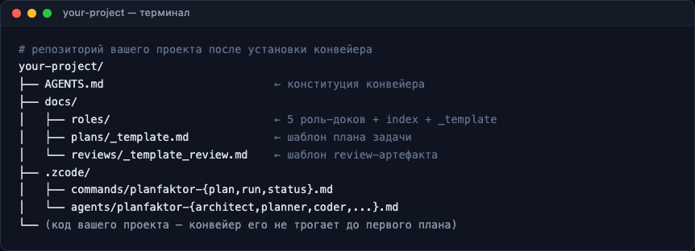
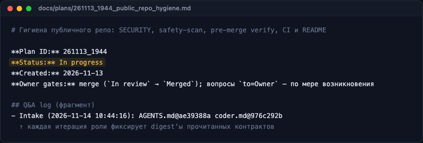
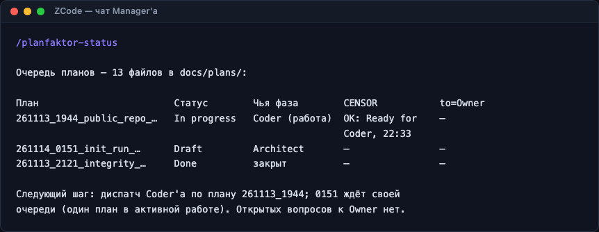

# Установка и первый запуск

Planfaktor — не устанавливаемый продукт: нет пакетов, зависимостей и
сервисов. «Установка» — положить контракты конвейера в репозиторий
вашего проекта; после этого конвейер запускается задачей в чате ZCode.
Эта страница — пошаговый путь от пустого репозитория до первого
merge-коммита. Что такое конвейер и как читать планы — в
[быстром старте](README.md).

## Что понадобится

- **ZCode** — агентская среда с чатом и субагентами (рабочая станция
  macOS / Linux / Windows);
- **git-репозиторий проекта**, в котором будет работать конвейер;
- **клон репозитория Planfaktor** — оттуда копируются контракты
  (обозначим путь переменной `$PF`).

Ничего больше: ни сервера, ни базы данных, ни очередей — процесс
исполняют сами агенты, а репозиторий помнит всё.

## Шаг 1. Положить контракты в репозиторий

Из клона Planfaktor в корень вашего репозитория копируется закрытый
набор файлов:

| Что | Откуда в `$PF` | Зачем |
| --- | --- | --- |
| Конституция | `AGENTS.md` | Правила конвейера: роли, статусы, гейты |
| Роль-доки | `docs/roles/*.md` | Пять доков ролей + индекс и шаблон |
| Шаблон плана | `docs/plans/_template.md` | Единственная форма артефакта задачи |
| Шаблон ревью | `docs/reviews/_template_review.md` | Артефакт двух ревью-лейнов |
| Команды Manager'а | `.zcode/commands/planfaktor-*.md` | `/planfaktor-init`, `/planfaktor-plan`, `/planfaktor-run`, `/planfaktor-status` |
| Субагенты ролей | `.zcode/agents/planfaktor-*.md` | Architect, Planner, Coder, два Reviewer'а |

Команды для копирования (из корня вашего репозитория):

```bash
cp "$PF/AGENTS.md" .
mkdir -p docs/plans docs/reviews docs/roles
cp "$PF"/docs/roles/*.md docs/roles/
cp "$PF/docs/plans/_template.md" docs/plans/
cp "$PF/docs/reviews/_template_review.md" docs/reviews/
mkdir -p .zcode/commands .zcode/agents
cp "$PF"/.zcode/commands/planfaktor-*.md .zcode/commands/
cp "$PF"/.zcode/agents/planfaktor-*.md .zcode/agents/
```

Опционально — справочник [`docs/lifecycle.md`](docs/lifecycle.md)
(путь плана по статусам) и плейбук
[терминального восстановления](docs/playbooks/manual_terminal_recovery.md)
(что делать, если конвейер встал). Сами планы и ревью в копировании
не нуждаются: их создаст конвейер.



После копирования закоммитьте контракты — с этого момента конвейер
живёт в истории вашего репозитория, как и код.

## Шаг 2. Открыть ZCode в корне проекта

Откройте ZCode так, чтобы корень репозитория был рабочим каталогом
сессии. Дальше всё подхватывается само:

- `AGENTS.md` в корне — инструкция проекта: сессия-Manager читает её
  как конституцию;
- `.zcode/agents/` — в сессии появляются субагенты пяти ролей;
- `.zcode/commands/` — в чате работают четыре команды Manager'а:
  `/planfaktor-init`, `/planfaktor-plan`, `/planfaktor-run`,
  `/planfaktor-status`.

Первое действие — `/planfaktor-init`: разовая инициализация
Manager-сессии (Manager перечитает контракты с диска и настроит
режим сессии).

Проверка без ожидания: выполните `/planfaktor-status` — Manager
перечитает `docs/plans/`, найдёт планов нет и отчитается пустой
очередью. Это и есть первый контакт с конвейером.

## Шаг 3. Первая задача — до merge-коммита

1. **Опишите задачу в чате обычными словами** — как коллеге: что нужно
   и зачем. Никаких форм и шаблонов от вас не требуется.
2. **`/planfaktor-plan`** — Manager создаст план из шаблона: имя вида
   `docs/plans/YYMMDD_HHMM_topic.md`, ваш бриф — дословно в Evidence,
   статус `Draft`. Дальше план читает Architect.
3. **Ответьте на вопросы.** Если в задаче есть неоднозначность,
   Architect спросит строкой `to=Owner` в Q&A log плана. Пока вопрос
   открыт — конвейер стоит; ваш ответ Manager перенесёт в план
   дословно.
4. **`/planfaktor-run`** — один шаг конвейера по старейшему активному
   плану. Команду можно давать сколько угодно раз: каждый вызов —
   диспатч очередной роли, CENSOR-проход или перевод статуса.
5. **Гейт merge.** После двух pass-вердиктов ревью Manager покажет
   выжимку и спросит «мержим?». Ваше явное «да» — и только оно —
   открывает merge-коммит.



## Что появляется в репозитории

Каждая задача оставляет след — его видно в файлах, без чата:

- `docs/plans/<PlanID>_topic.md` — план: статус в шапке, решения,
  критерии приёмки, Q&A log, Evidence, учёт токенов;
- `docs/reviews/<PlanID>_review.md` — вердикты двух лейнов по раундам;
- merge-коммит `type(PlanID): summary` — после вашего «да»;
- закрытый план остаётся в истории навсегда (статус `Done`).

## Команды Manager'а

| Команда | Что делает |
| --- | --- |
| `/planfaktor-init` | Разовый старт Manager-сессии: свежее чтение контрактов, режим сессии |
| `/planfaktor-plan` | Создаёт план из вашего брифа |
| `/planfaktor-run` | Один шаг конвейера по старейшему активному плану |
| `/planfaktor-status` | Статусы планов и очередь работ — без изменений |



## Частые вопросы первого запуска

- **Конвейер «ничего не делает».** Смотрите строку `**Status:**` в
  шапке плана и открытые вопросы `to=Owner` в Q&A log — почти всегда
  конвейер ждёт именно вашего ответа.
- **Где мой план?** `docs/plans/`, имя — дата и время создания. Имя
  менять нельзя: по нему строится очередь.
- **Задача переросла план.** Скажите об этом: Architect переведёт план
  в `Superseded` со ссылкой на преемника.
- **Хочу понять, почём задача.** Секция `## Token usage` в плане:
  usage-строка на каждый диспатч роли и CENSOR-проход.
- **Конвейер встал намертво.** Плейбук ручного восстановления —
  [терминальное восстановление](docs/playbooks/manual_terminal_recovery.md).

## Что дальше

- [Быстрый старт Owner'а](README.md) — роли, гейты, чтение планов;
- [Конституция](AGENTS.md) — все правила конвейера;
- [Жизненный цикл плана](docs/lifecycle.md) — путь статусов
  от Draft до Done.
