# Модельный прогон: жизнь одной задачи от брифа до Done

Это не схема и не макет — реальный план конвейера `261114_0151`
(команды `/planfaktor-init` и `/planfaktor-run [PLAN_PATH]`), снятый
целиком: от брифа Owner'а в чате до статуса `Done` и closeout-коммита.
Каждая цитата и цифра — из файлов плана, review-артефакта и
`## Token usage`; кадры — рендеры реальных фрагментов артефактов
(подписи в кадрах указывают источник). Прогон занял одну рабочую
сессию: старт 02:43, merge-гейт открыт ночью и открыт Owner'ом
утром в 11:07, closeout — 11:08.

Как устроен сам конвейер — в [быстром старте](README.md) и
[конституции](AGENTS.md); здесь — как это выглядит в движении.

## Шаг 0. Бриф Owner'а

Задача ставится обычным сообщением в чате — никаких форм. Владелец
этого прогона запустил его одной фразой (дословная цитата зафиксирована
в Evidence плана в момент старта):

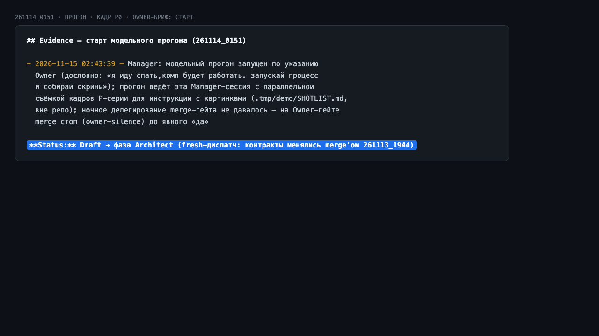

Живой UI в момент старта — окно ZCode, где идёт сессия Manager'а:

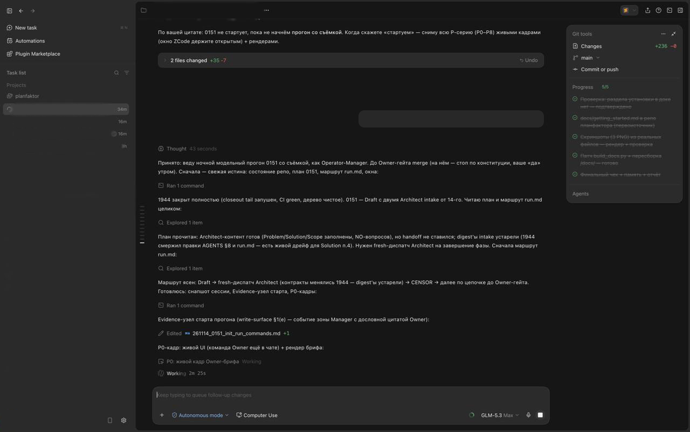

## Шаг 1. Понимание: Architect и «Как я понял задачу»

Первой фазу входит Architect: читает конституцию и план, записывает
блок «Как я понял задачу» — 3–7 строк, которые Manager дословно
ретранслирует Owner'у. Это точка чтения человека: владелец видит,
как конвейер понял задачу, ещё до того, как написан хоть один пункт
DoD. Границы `## Scope` фиксируются здесь же — что меняем и что
принципиально не трогаем.

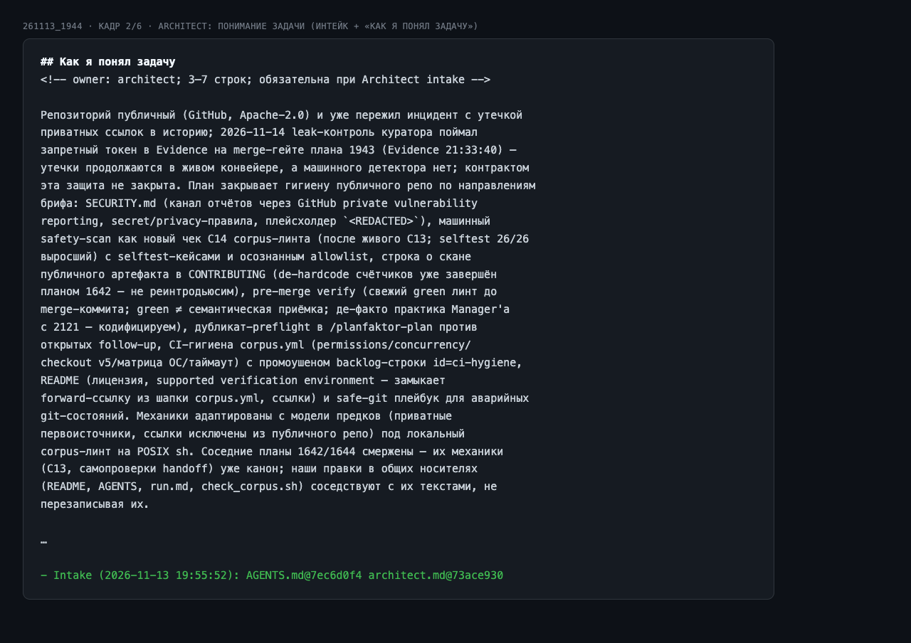

Handoff Architect'а — статус `Ready for Planner` — обязан пройти
CENSOR: тот же субагент заново сверяет свою работу по файлам, а не
по памяти. В этом прогоне CENSOR нашёл и поправил три мелочи своей
зоны (устаревшие упоминания соседних планов, форму пересъёмки
скриншота) — вердикт OK:

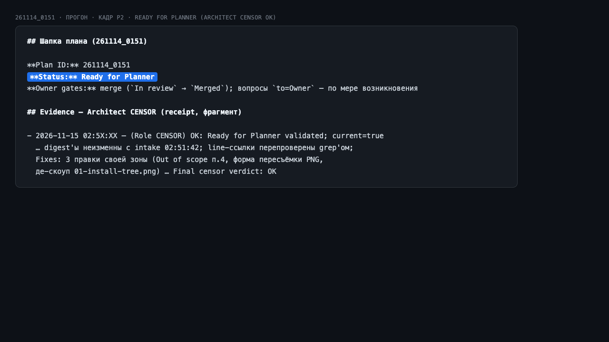

## Шаг 2. Как конвейер спрашивает Owner'а

Если в задаче есть неоднозначность, роль открывает вопрос строкой
в `## Q&A log` — и конвейер останавливается, пока ответ не придёт
парной A-строкой. В этом прогоне вопросов не возникло, поэтому
механика показана на реальной паре из другого плана корпуса
(recovery-гонка двух итераций, вопрос Coder'а — ответ Manager'а):

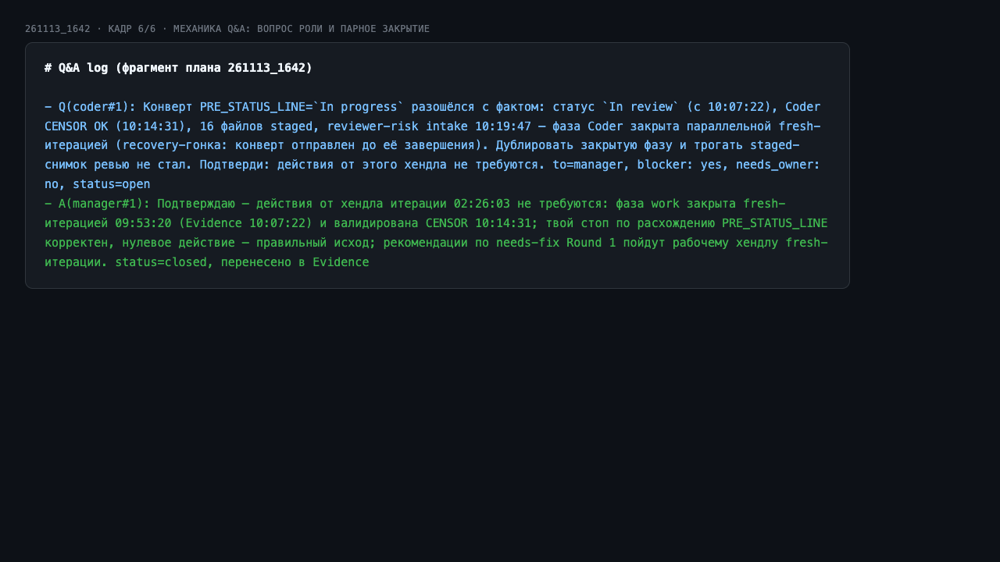

## Шаг 3. Планирование: план становится проверяемым

Planner превращает решения Architect'а в критерии приёмки DoD
(D1–D14) и команды проверок Tests (T1–T14, покрытие 14/14) — каждое
утверждение проверяемо командой с ожидаемым результатом. Затем
handoff `Ready for Coder` со своим CENSOR.

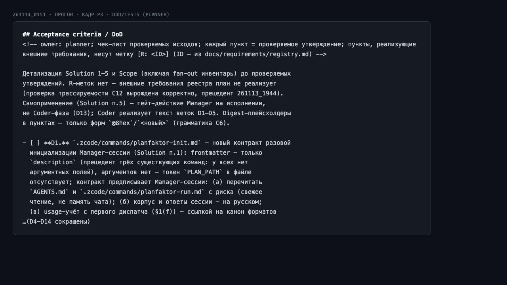

## Шаг 4. Авто-переход: открытых вопросов нет

Переход `Ready for Coder → In progress` Manager делает без гейта:
перечитывает Q&A log, убеждается, что открытых вопросов к Owner'у нет,
ставит статус с Evidence-записью. Единственный обязательный гейт
человека впереди — merge.

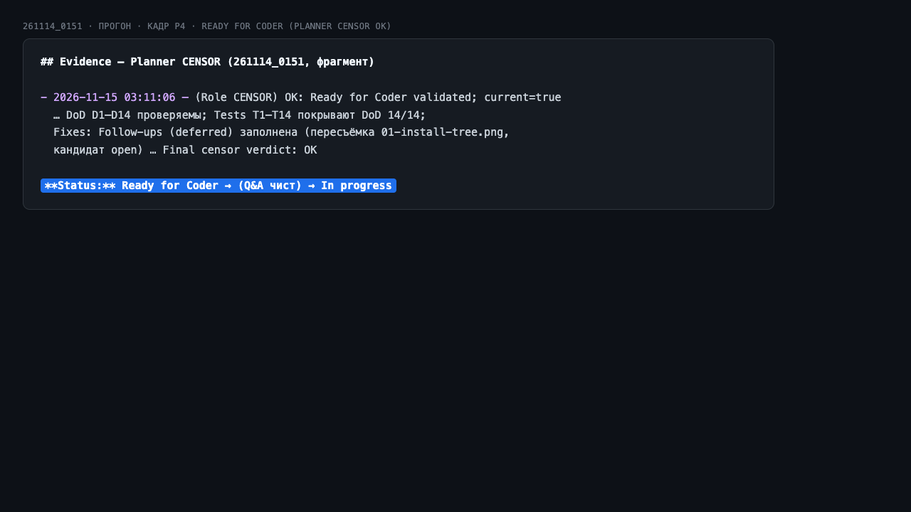

## Шаг 5. Реализация: Coder, staged без коммита

Coder работает строго по DoD: до правок фиксирует исход каждого
пункта (AC-to-test: `explicit assertion` | `existing proof` | `N/A`),
реализует, прогоняет тесты, стейджит — но не коммитит. Коммит в
конвейере делает только Manager и только после Owner-«да». В этом
прогоне: staged ровно 7 файлов Scope, `corpus: clean`,
selftest 33/33, Coder CENSOR OK.

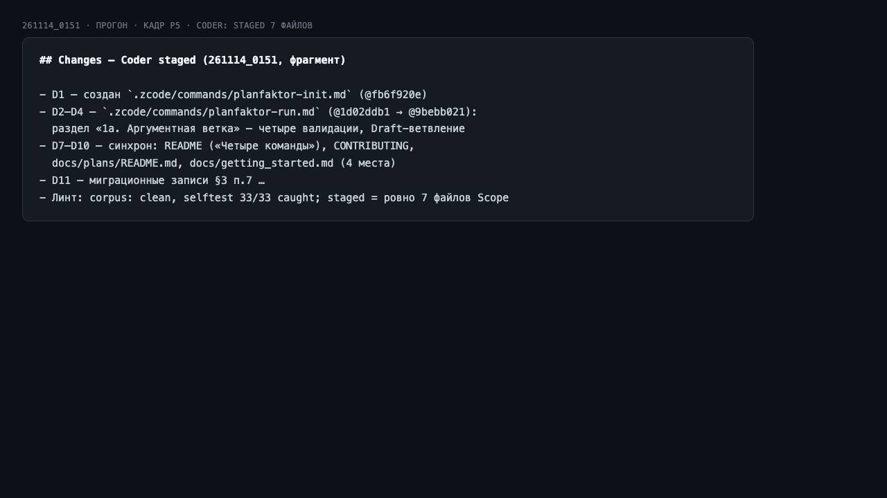

## Шаг 6. Ревью: два независимых лейна

Risk-лейн ищет риски и edge cases, contracts-лейн сверяет результат
со Scope/DoD. Вердикты — в review-артефакт, по раундам. Итог прогона:
`pass × 2`, терминальное состояние `current_green`, одна minor-находка
S3 ушла в follow-up.

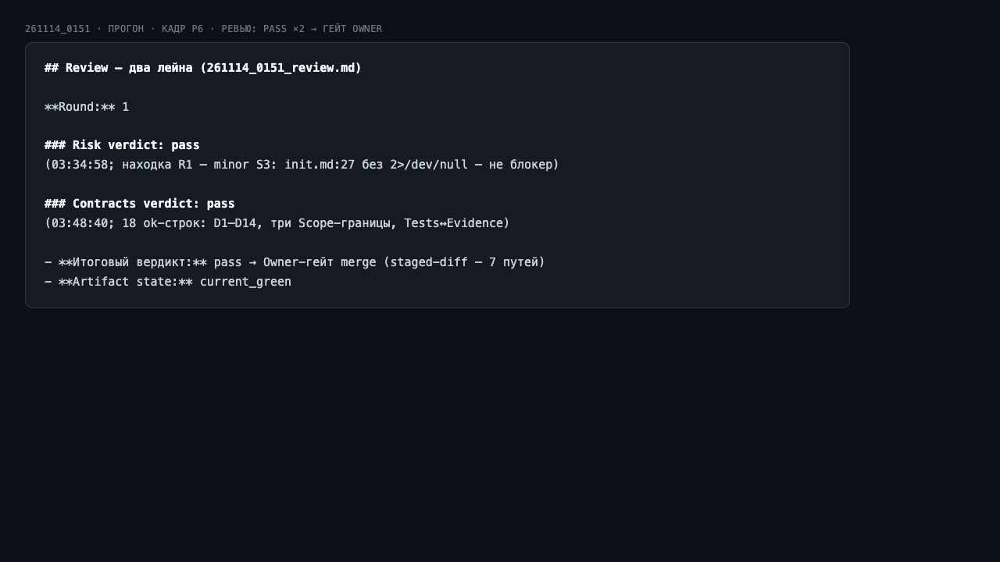

## Шаг 7. Единственный гейт человека: merge

После двух pass Manager показывает выжимку и спрашивает «мержим?».
Ночью гейт простоял в owner-silence — конвейер не трогает ничего,
пока ответа нет. Утром Owner ответил «мержим» — дословная цитата
зафиксирована в Evidence, контроли пройдены (свежий corpus-линт,
запретный grep по staged — 0), merge-коммит создан:

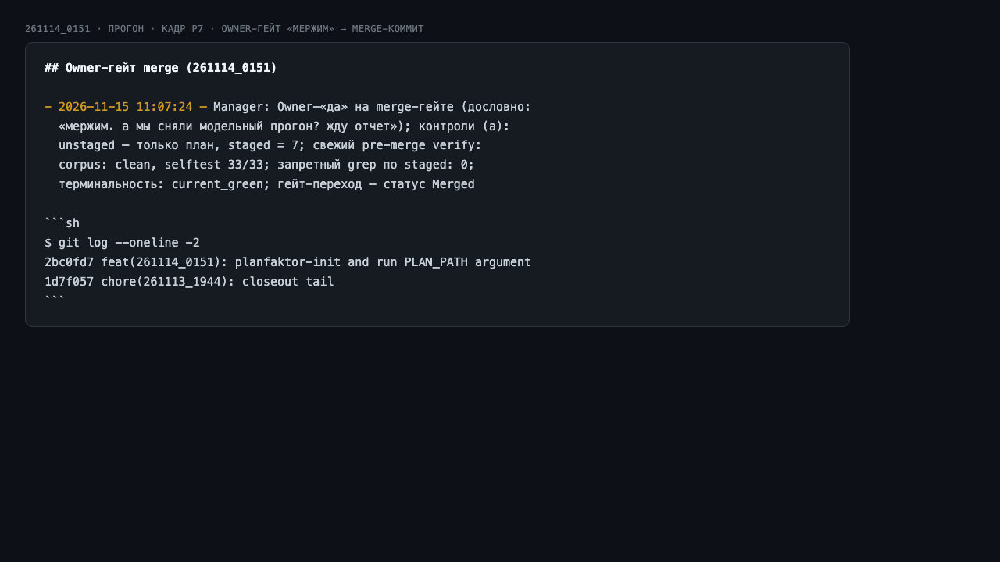

## Шаг 8. Closeout: Done и harvest

`Merged → Done` — это инвентаризация: Follow-ups заполнен, каждый
отложенный хвост получает судьбу (backlog-строку), ничего не теряется.
Прогон закрыт статусом `Done`, план остаётся в `docs/plans/` навсегда.

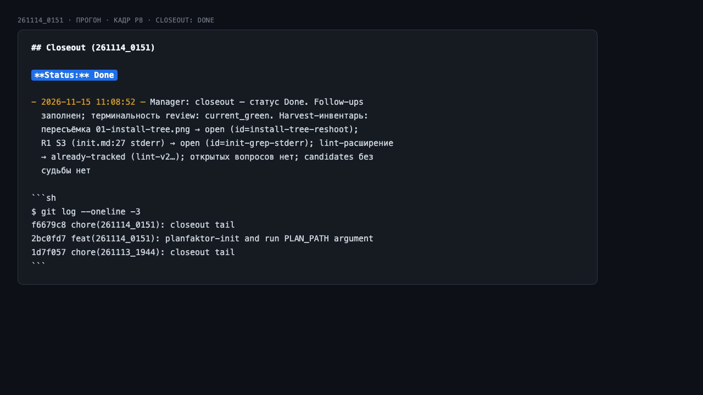

## Что стоил прогон

Usage-строки пишутся в план на каждый диспатч роли и CENSOR-проход —
стоимость задачи видна по фазам (числа — учёт харнесса, приближение):

| Фаза | Проход | Токены |
| --- | --- | --- |
| Architect | work + censor | 3,64 млн + 1,39 млн |
| Planner | work + censor | 1,56 млн + 0,81 млн |
| Coder | work + censor | 4,82 млн + 2,00 млн |
| Reviewer-risk | work | 1,57 млн |
| Reviewer-contracts | work | 2,99 млн |
| **Итого субагентов** | | **≈ 18,8 млн** |

Конвейер не экономит токены — он делает их расход видимым и
подотчётным: доработки, ревью и цензорные проходы разложены по строкам,
а не спрятаны в счётчике сессии.

## Как воспроизвести самим

1. Положить контракты конвейера в репозиторий —
   [Установка и первый запуск](getting_started.md);
2. Дать задачу в чате и вызвать `/planfaktor-plan`;
3. Вести прогон командой `/planfaktor-run` — до вопроса «мержим?».
